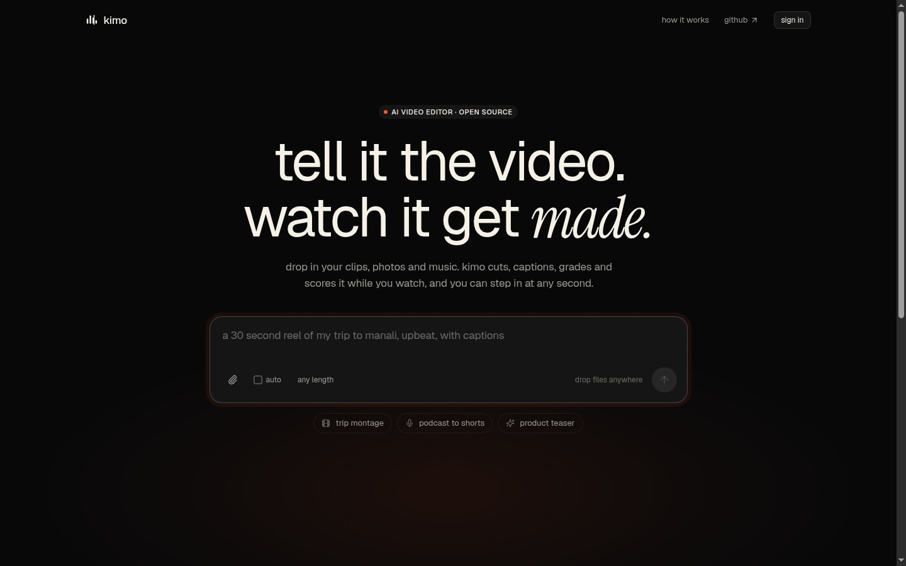
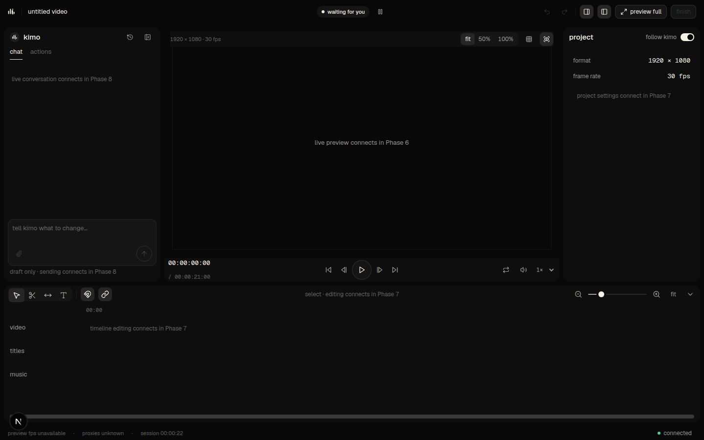

# kimo web

Browser frontend for kimo: prompt and mixed-file input, warm-up, a live-editing
Studio, review, render progress and delivery. The marketing site remains
`getkimo.tech`; `app.getkimo.tech` is the intended app host, **not a verified
production deployment**.

## Current status

Phases 0 through 9 have tested source checkpoints. The latest published Phase 9
checkpoint is `0fd12a0905c08ae7f798251caf05953d78118ce8`: stable lint, strict
TypeScript, 900 tests in 88 files and production build were verified by the
integration owner. That does **not** mean all phases are accepted or the product
is finished. Phase 10 hardening and docs/tests are in progress; changes after that
checkpoint require fresh integration gates.

The bounded Phase 8 synthetic browser check verified automatic navigation to
Studio, chat/actions interactions, seek, text editing, undo/redo and saved title/
project-note edits after same-session reload. Chat/action history disappeared on
reload and reconnects recurred. Exact interrupt/ACK ordering remains unverified.
The managed environment reported GPU unavailable **before renderer initialization**;
there is no accepted shader/pixel, A/V-sync, hardware-performance or engine-fidelity
result. The Phase 9 browser gate is separately owned and is not inferred here.

Real REST/WS backend, production model capabilities, Google auth/cookie flow,
anonymous quota enforcement, retention, deployment, complete cross-browser QA,
VoiceOver/NVDA and performance acceptance remain unverified. No `v1.0.0` release
or production launch is claimed. See [phase evidence](docs/PHASE_LOG.md),
[state inventory](docs/STATES.md), [accessibility and device matrix](docs/A11Y.md)
and [authored browser harness](e2e/README.md).

## Architecture

```text
apps/web (Next.js App Router, React, token-based UI)
  / -> /warmup/:sessionId -> /studio/:sessionId
                              -> /render/:sessionId -> /v/:videoId
  /privacy, /dev/tokens, /dev/ui, /dev/compositor
       |
       +-- stores + one editing authority (acknowledged / pending / draft)
       |     +-- device-local recovery/outbox (Phase 10 IDB work in progress)
       +-- single session WS lifecycle + authoritative REST restoration
       +-- packages/compositor (Pixi / bounded media / shared audio graph)
       +-- packages/kimo-client (Zod REST/WS validation + typed operations)
                     |
                     +-- packages/mock-server (synthetic fixtures, local only)
                     OR
                     +-- agreed real backend (not verified)
                           model keys / auth / quota / storage / engine / jobs
```

Frontend schema proposals and mock behavior do not establish production backend
agreement. Unknown mutation acceptance is not rejection: do not blindly repeat
approvals/edits. See [contracts](docs/CONTRACTS.md). Device recovery is not a server
backup, and mock sessions/jobs/videos exist only while the mock process runs.

## Run with the mock

Requires Node 22+, pnpm 9.x and FFmpeg on PATH for generated original fixtures.

```sh
corepack prepare pnpm@9.15.9 --activate
pnpm install
cp .env.example apps/web/.env.local
pnpm dev:mock
```

The supervisor starts the web app (3000) and mock (8787), checks readiness and
cleans up children. Alternatively use `pnpm mock` and `pnpm dev` in separate
terminals. `pnpm mock:demo` exercises the scripted synthetic WebSocket sequence.
`MOCK_SPEED=2 pnpm mock` changes timing;
`MOCK_FAIL=upload|ws|render pnpm mock` selects one failure value at a time, for
example `MOCK_FAIL=render pnpm mock` (do not pass the literal pipe expression).
Upload data stays in ignored `.mock-data`; use synthetic files only.

Mock media are original test patterns. Render JPEGs are illustrative; delivered
MP4s are pre-generated eight-second **silent** patterns, not the project or a
real engine render. Ellipse masks are synthetic, not SAM inference. A schema field
or UI label for an image/music/caption does not prove web search, audio mixing,
transcription or burn-in. Do not use the mock for private content or production.

## Configure a real backend

First obtain the authoritative backend service and agreement described in
[contracts](docs/CONTRACTS.md). No production API URL is supplied by this README.
Never substitute the marketing site or a local MCP endpoint for the `/v1` API.

```sh
# Replace placeholders with owner-approved endpoints in apps/web/.env.local:
NEXT_PUBLIC_KIMO_API=https://<approved-rest-host>/<optional-prefix>
NEXT_PUBLIC_KIMO_WS=wss://<approved-websocket-host>
NEXT_PUBLIC_SITE_URL=https://app.getkimo.tech
# Then rebuild public configuration:
pnpm build
pnpm --filter @kimo/web start
```

These env assignments illustrate a file, not executable shell placeholders.
`NEXT_PUBLIC_KIMO_API` is a base to which `/v1/...` is appended.
`NEXT_PUBLIC_KIMO_WS` is an origin-only override; preserve the backend-issued
session socket path/query. Never place per-session tokens in public config.
Production requires explicit HTTPS/WSS configuration and agreed media CORS.
Server-only internal transport and narrowly approved SSR cookie forwarding are
explained in `.env.example`; configure them only with backend authority. Auth
requires backend-issued httpOnly cookies and an agreed redirect/CSRF policy,
not a frontend-created credential. Server quota enforcement cannot be replaced
by a browser counter.

**No engine/model API keys, Google secrets, credentials or service tokens belong
in frontend code, `NEXT_PUBLIC_*`, fixtures, documentation or committed env files.**
All model/engine calls and secret ownership stay with the backend.

## Checks and browser evidence

The integration owner runs `pnpm lint && pnpm typecheck && pnpm test && pnpm build`
on settled source. Browser commands `pnpm e2e` and `pnpm shots` are for a separately
authorized runner only; this docs/test authoring did not execute them. See
[e2e setup and limitations](e2e/README.md). No Phase 10 visual baseline has been
captured. Chrome, Edge, actual Safari 18+, Firefox, all five specified viewports,
native 200% zoom, keyboard, reduced motion and high contrast need distinct
receipts. WebKit automation is not actual Safari acceptance.

[Temporary preview](docs/TEST_PREVIEW.md) is bounded, synthetic and explicitly
not production. Its dev-route restrictions differ from an isolated test runner.
[Three-minute demo](docs/DEMO_SCRIPT.md) separates available mock behavior from
real capability-dependent footage. [Marketing link proposal](docs/MARKETING_LINK.md)
does not change the separate marketing repository.

## Existing screenshots, not Phase 10 baselines

These existing PNGs were visually inspected, matched to the published checkpoint's
Git blobs, and are historical managed-browser captures. No image was generated
or recaptured for this documentation. They do not show the current Phase 10 UI.





The Studio image deliberately shows older phase placeholders, not a functioning
GPU composition. No verified public Phase 10 privacy, review/render/delivery or
full-state baseline image exists in this handoff. The historical mobile image's
500px capture raster and explicitly cropped watch-mode image are not exact 390px
visual baselines; details remain in the phase log.
